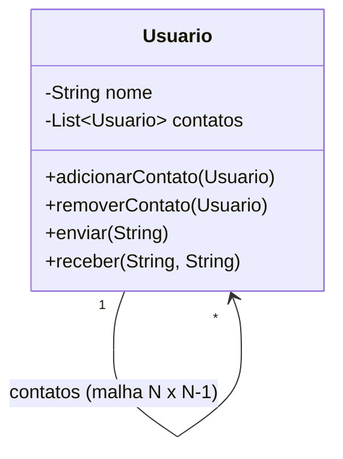
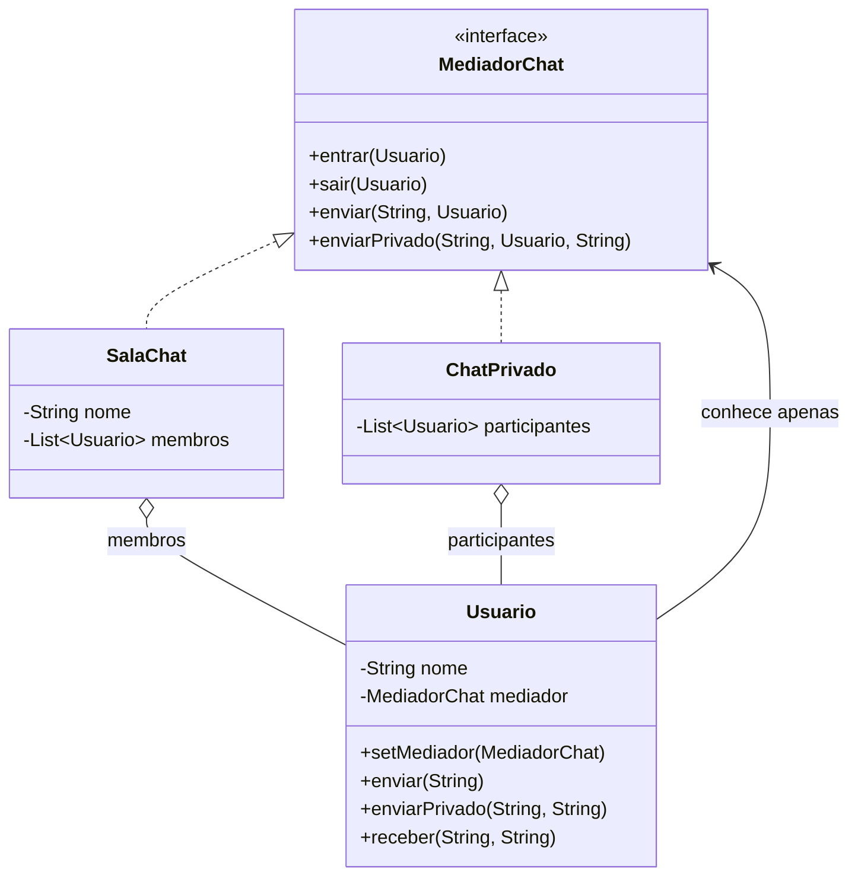

# Exercício 2 — Rastreando o anti-pattern (Mediator)

## 1. Quantas ligações podem existir? O que indica sobre o acoplamento?

Cada `Usuario` guarda referências diretas aos demais. Para **N** usuários existem até **N × (N − 1)** referências (dirigidas), ou N(N − 1)/2 pares de conversa.

| Usuários | Referências |
|---|---|
| 3 | 6 |
| 4 | 12 |
| 10 | 90 |
| 100 | 9.900 |

O crescimento é **quadrático, O(N²)**. Isso indica **acoplamento alto e muitos-para-muitos**: todo colega conhece todos os outros, então `Usuario` não pode ser entendido, testado ou reutilizado isoladamente. Além disso, `adicionarContato` é unidirecional: Ana pode conhecer Bruno sem que Bruno conheça Ana, e nada garante a simetria.

## 2. Incluir o Diego e remover alguém

**Para incluir o Diego (3 usuários já na sala) é preciso:**

1. `Main`: criar `diego`.
2. `Main`: `diego.adicionarContato(...)` 3 vezes (ana, bruno, carla).
3. `Main`: `ana.adicionarContato(diego)`, `bruno.adicionarContato(diego)` e `carla.adicionarContato(diego)`.

São **6 ligações novas (2N)**, e o estado interno de **todos** os `Usuario` existentes é alterado. Esquecer uma chamada deixa a malha inconsistente (o Diego fala, mas alguém não ouve).

**Para remover a Carla:**

- É preciso chamar `removerContato(carla)` em **cada** outro usuário (N − 1 chamadas).
- **Referências soltas:** se esquecermos uma lista, a Carla continua recebendo mensagens; ela ainda guarda referências para os outros e continua podendo enviar; e, enquanto alguém a referenciar, ela não pode ser coletada pelo GC.
- Remover durante o `for` de `enviar` pode gerar `ConcurrentModificationException`.
- Não existe um lugar único que saiba "quem está na sala".

## 3. Onde devem morar as regras de conversa?

Em um **objeto mediador** (a sala), e não nos usuários.

- **Coesão / responsabilidade única:** `Usuario` representa uma pessoa (nome, receber mensagem). Decidir *quem* recebe é responsabilidade do grupo, não de cada participante.
- **Um único ponto de mudança:** "só o admin fala", "mensagem privada" ou "silenciar alguém" se alteram em um só lugar, sem tocar nos N usuários.
- **Reuso:** a mesma classe `Usuario` funciona com regras diferentes, bastando trocar o mediador.
- **Testabilidade:** as regras podem ser testadas sem criar a malha de usuários.

## 4. Refatoração com Mediator

### Diagrama — antes



### Diagrama — depois



### Estrutura no projeto

```
projeto_mediator/
├── pom.xml
├── README.md
└── src/main/java/br/venson/net/designpatterns/mediator/
    ├── MediadorChat.java   (interface do mediador)
    ├── SalaChat.java       (mediador concreto)
    ├── ChatPrivado.java    (outro mediador concreto)
    ├── Usuario.java        (colega, conhece só o mediador)
    └── Main.java
```

### Papéis

- **Interface de mediador:** `MediadorChat`
- **Mediador concreto:** `SalaChat` (e `ChatPrivado`)
- **Colega:** `Usuario`

Código: ver os arquivos em `src/main/java/br/venson/net/designpatterns/mediator/`.

### Justificativa de cada decisão

- **`MediadorChat` como interface:** `Usuario` depende de uma abstração (inversão de dependência), então pode conversar em qualquer tipo de chat sem conhecê-lo.
- **`SalaChat` guarda a lista de membros e as regras:** a malha N × (N − 1) vira uma estrela com N ligações; o conhecimento de "quem está aqui" e "quem recebe o quê" fica centralizado.
- **`Usuario` só guarda `MediadorChat`:** deixa de conhecer pares, ficando simples e reutilizável. `enviar` apenas delega ao mediador.
- **`entrar`/`sair` ajustam `setMediador`:** o mediador mantém os dois lados consistentes, e ao sair o usuário fica sem referência (`null`), eliminando referências soltas.
- **`enviar` itera sobre uma cópia da lista:** evita `ConcurrentModificationException` se alguém sair durante o envio.
- **`enviarPrivado` na interface:** mostra que uma regra nova (privado) entra no mediador sem mexer nos colegas.
- **Validação de pertencimento:** quem não está na sala não pode enviar (`IllegalStateException`), uma regra que antes não tinha onde morar.

## 5. Depois de refatorar

**Incluir/remover usuário:**

| | Antes | Depois |
|---|---|---|
| Incluir Diego | 6 chamadas em vários objetos (2N) | `sala.entrar(diego)` (1 chamada) |
| Remover Carla | N − 1 chamadas, risco de referências soltas | `sala.sair(carla)` (1 chamada; o mediador limpa os dois lados) |
| Ligações totais | N × (N − 1) | N |

**Reuso de `Usuario`:** a classe não muda. Para uma sala com outras regras ou um chat privado, basta entrar em outro mediador:

```java
ChatPrivado privado = new ChatPrivado();
privado.entrar(ana);
privado.entrar(bruno);
ana.enviar("Agora estamos so nos dois.");
```

Uma nova regra (ex.: `SalaAvisos`, em que só o admin fala) é só uma nova implementação de `MediadorChat`; `Usuario` continua intacto (princípio aberto/fechado).